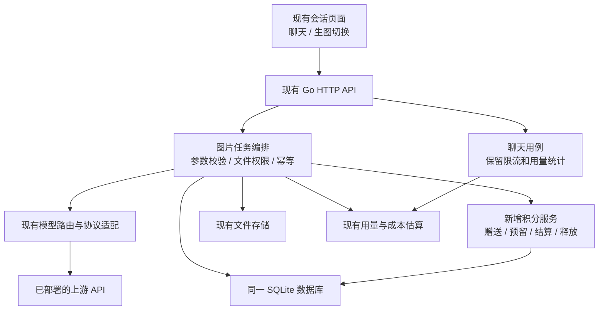

# Kayqi-Chat 对话式生图与积分系统开发方案

编制日期：2026-10-20。本文保留开发前的设计依据与实施计划。现已按后续开发授权实现，当前运行、启用顺序与验收范围见 [运行与验收说明](KAYQI-CHAT-OPERATIONS.md)。未执行生产部署。

## 1. 需求依据与源码基线

需求依据为[网页端分享对话](https://chatgpt.com/share/6ad67278-021c-83ec-bb03-9bbf4fb6c2ff)，以你最后提出的“在对话中切换聊天／生图，并将已经发送的图片加入编辑”为最终产品方向。

本地核对基线：

| 项目 | 当前情况 |
| --- | --- |
| 工作目录 | `D:/code/ai-coding/Kayqi-Chat` |
| 分支 | `dev-kayqi` |
| 提交 | `074156e8c7d94a47136bbd400736948eee91bd85` |
| 项目版本 | `0.4.6-beta.1` |
| 前端 | Next.js 16.3.8、React 19.2.8、TypeScript、Tailwind CSS、现有组件系统 |
| 后端 | Go、Gin、GORM，按 application / domain / repository / infra / transport 分层 |
| 目标环境 | 面向多用户的 Web 服务，2 核 2GB 单机起步 |

编制方案时仅核对本地源代码和部署模板。下文保留当时“代码已具备”“建议开发”“需要联调验证”的设计分类；后续实现及实际验证结果以 [开发验证记录](KAYQI-CHAT-VERIFICATION.md) 为准，未访问生产数据库或调用真实生图上游。

## 2. 产品范围与默认规则

### 2.1 首版交付范围

1. 保留现有聊天页面、会话历史、分支、文件管理、用户管理、模型路由和 Token 统计。
2. 在同一输入框增加“聊天／生图”显式模式切换，同一会话可交替使用两种模式。
3. 生图模式提供模型、质量、比例／尺寸、张数选择；选项根据实际模型能力展示。
4. 支持上传、拖入、粘贴参考图；用户上传图和生成结果图均可“加入编辑”。
5. 多张参考图按 `fileID` 去重，支持移除、跨轮次复用；结果继续进入当前会话。
6. 展示积分余额、预计消耗、实际消耗、失败和部分成功状态。
7. 后台配置注册赠送、每日赠送、图片价格、执行并发；支持用户积分查询、流水和人工调整。
8. 免费聊天继续受服务端限流和模型权限约束；图片生成、编辑统一校验积分。

保留原项目设计语言和中英文国际化方式。首版不新增独立绘画工作台、第二套图片历史、支付充值、会员积分包或新的桌面端功能。原有相关能力可以保留，前台入口是否展示由产品配置统一决定。

### 2.2 待确认业务规则的建议取值

这些是便于实施的建议，尚不代表你已经逐项确定；可以在相应阶段开始前调整。

| 规则 | 建议默认值与含义 |
| --- | --- |
| 注册赠送 | 后台配置，允许为 0；进入永久积分，只发一次 |
| 每日赠送 | 后台配置，按 `Asia/Shanghai` 自然日，在当天首次进入生图／领取时惰性发放 |
| 每日额度有效期 | 当日有效，次日失效；永久积分持续保留 |
| 消耗顺序 | 先使用当日积分，再使用永久积分 |
| 新用户首日 | 可以领取当天每日积分；注册奖励与每日额度分开展示 |
| 老用户上线迁移 | 建立 0 永久积分账户，不自动补发历史注册奖励；可领取上线后的每日额度 |
| 管理员创建／导入账号 | 默认不享受公开注册奖励，由管理员另行调整 |
| 第三方注册 | 若启用，应与邮箱自助注册享受同一套一次性奖励规则 |
| 图像编辑价格 | 首版默认与同模型、同质量、同尺寸的文生图一致，允许后台单独定价 |
| 重新生成 | 创建新任务，按当前价格重新报价、重新扣费 |
| 每用户执行并发 | 1 个图片任务 |
| 全站执行并发 | 先设 1，压测通过后尝试 2；不作为已经验证的承载量 |
| 输出数量 | 默认 1 张；上限最多 4 张，但模型不支持时只开放 1 张 |
| 参考图 | 首版建议最多 4 张，实际取应用配置、模型能力和现有附件限制的最小值 |

“注册送 0”表示注册奖励为 0。若每日赠送非 0，新用户领取后仍会有当日积分；若要求首次进入页面总积分也为 0，需要同时把每日赠送设为 0，或另行修改首日领取规则。

## 3. 本地现状与网页方案的修正

| 能力 | 本地源码证据 | 对开发范围的影响 |
| --- | --- | --- |
| 图片生成与编辑 | [service_media_generation.go](D:/code/ai-coding/Kayqi-Chat/backend/internal/application/conversation/service_media_generation.go:75) | 已有独立媒体任务链路，直接扩展 |
| 图片请求参数 | [dto_request.go](D:/code/ai-coding/Kayqi-Chat/backend/internal/transport/http/conversation/dto_request.go:194) | 已有 `options`、`fileIDs`、`maskFileID`、`clientRunID` |
| 图片参数面板 | [chat-input.tsx](D:/code/ai-coding/Kayqi-Chat/apps/web/features/chat/components/sections/chat-input.tsx:430)、[chat-option-controls.ts](D:/code/ai-coding/Kayqi-Chat/apps/web/features/chat/model/chat-option-controls.ts) | 已有媒体参数弹窗、控件解析和常见参数选项，优先增强现有机制 |
| 参数传至上游 | [openai_images.go](D:/code/ai-coding/Kayqi-Chat/backend/internal/infra/llm/openai_images.go:539) | 已传递 `quality`、`size`、`n`；不需要重建 Images 适配器 |
| 生成结果加入编辑 | [use-chat-media-attachment-actions.ts](D:/code/ai-coding/Kayqi-Chat/apps/web/features/chat/hooks/use-chat-media-attachment-actions.ts) | 已有 `fileID` 去重、追加附件和编辑模型切换 |
| 用户图片展示 | [message-user.tsx](D:/code/ai-coding/Kayqi-Chat/apps/web/features/chat/components/message/message-user.tsx:301) | 需要将编辑动作接入用户图片及通用附件组件 |
| 任务选择 | [chat-task.ts](D:/code/ai-coding/Kayqi-Chat/apps/web/features/chat/model/chat-task.ts) | 目前主要从模型能力和附件推导，需要引入用户显式模式 |
| 断线与任务恢复 | [handler_media.go](D:/code/ai-coding/Kayqi-Chat/backend/internal/transport/http/conversation/handler_media.go)、[generation_stream.go](D:/code/ai-coding/Kayqi-Chat/backend/internal/application/conversation/generation_stream.go) | 已有脱离浏览器连接的执行生命周期、事件回放和中断标记；进程重启后的积分对账需新增 |
| 原有账务 | [billing/service.go](D:/code/ai-coding/Kayqi-Chat/backend/internal/application/billing/service.go:1252) | `self` 模式不预扣原货币余额，仍可记录用量；适合作为首版统计基础 |
| 表名规则 | [table_prefix_test.go](D:/code/ai-coding/Kayqi-Chat/backend/internal/infra/persistence/models/table_prefix_test.go) | 新表建议使用 `billing_` 前缀，不能直接照搬网页方案的裸 `point_wallets` |
| 动态配置规则 | [registry.go](D:/code/ai-coding/Kayqi-Chat/backend/internal/application/settings/registry.go) | 配置由 namespace + key 组成，完整键采用 `points:signup_bonus` 形式 |
| SQLite 部署 | [docker-compose.sqlite.yml](D:/code/ai-coding/Kayqi-Chat/deploy/docker-compose.sqlite.yml) | 已有单应用容器、SQLite、内存缓存和持久化卷 |

因此，主要新增工作是产品模式、能力约束、积分钱包及任务结算，现有媒体链路和参数系统可以复用。

此外，现有图片任务向上游发送的是本轮提示词和本轮明确选中的参考图，并非自动传递整个图片会话。首版“多轮编辑”以显式“加入编辑”为基础。用户只输入“把上一张改成蓝色”而没有选择参考图时，不能默认保证模型知道上一张图片。

## 4. 总体技术方案

继续使用现有技术栈和模块化单体，静态前端由 Go 服务托管：



积分服务按现有分层实现。Web 不直接连接上游、不持有上游密钥；浏览器预估价格只用于展示，后端根据实际生效参数核算和授权。

首版把原有 `billing:mode` 配为 `self`，保留模型价格与用量记录，用新积分系统约束图片任务。不把原货币价格全部改为免费，避免丢失有用的金额估算。原记录中的金额需要在界面明确标注为用量／成本估算，用户消费以积分为准。

该方案的首版范围是全站免费聊天与图片积分。如未来要同时恢复原来的按量／订阅收费，需要补充按任务选择收费策略，不能只改回全局计费模式，否则可能同时扣货币余额和积分。

## 5. 对话与前端交互设计

### 5.1 输入框与模式状态

建议输入框从上到下为：参考图缩略图、文本输入区域、底部“聊天／生图”切换与模型／参数按钮、发送按钮。生图时显示“高质量 · 1:1 · 1 张”和“预计 10 积分”；具体文字按真实能力与报价生成。

新增 `ChatComposeMode = chat | image`，与实际任务类型分开：

| 用户模式 | 附件与能力 | 实际任务 |
| --- | --- | --- |
| 聊天 | 聊天模型，允许按现有规则理解图片 | `chat` |
| 生图 | 没有参考图，模型支持生成 | `image_generation` |
| 生图 | 存在参考图，模型支持编辑 | `image_edit` |
| 生图 | 存在参考图，模型不支持编辑 | 阻止发送并提示选择可编辑模型 |

必须同时修改输入框提示与实际提交决策，不能只新增一个切换按钮。尤其是既支持聊天又支持编辑的模型：聊天模式上传图片时必须仍执行图片理解，不能按现有优先级意外转为编辑。

状态沿用现有 composer 状态机制，以服务器、用户、会话为作用域，分别记住聊天模型、生图模型与各自参数。切换模式保留草稿和附件，清除不属于目标任务的参数；生图不携带聊天工具、Skill、知识库选择。提交时固化模式、模型、参数、参考图和 `clientRunID`，之后切换模式不影响已提交任务。

新会话默认聊天。恢复历史会话时可按最近一轮任务类型初始化模式，但 `chat_runs.task_type` 表达的是历史任务事实，不能替代当前输入框状态。因图片任务会更新会话的当前模型，需要单独保留最近使用的聊天模型。

首版只在持久化会话开放积分生图；临时聊天模式的图片入口隐藏，服务端同步拒绝不受支持的图片调用。

### 5.2 加入编辑

1. 用户上传图和生成图都提供“加入编辑”；共享只读页面不展示此操作。
2. 点击后复用原 `fileID`，加入当前草稿参考图列表，重复点击不重复添加。
3. 自动切换生图模式；优先保留当前支持编辑的模型，其次选择来源模型或可用编辑模型。
4. 没有可编辑模型时给出明确提示，不能悄悄执行文生图或丢弃参考图。
5. 支持从不同轮次添加多张图片，并在输入框移除；超出有效上限时拒绝新增。
6. 提交时只发送明确选中的参考图；后端重新验证归属、文件类型、文件是否存在及大小限制。

### 5.3 参数面板

复用 `optionControls`、`defaultOptions` 和现有媒体参数弹窗，在其上增加更适合普通用户的中文名称、参数摘要、联动和价格展示。只有现有组件无法满足布局时才拆出专用图片参数组件。

质量和数量最终对应上游有效字段。比例与分辨率应映射为模型支持的具体尺寸组合；不能把 `1024x1536` 标成 `9:16`，也不能假定每个 OpenAI 兼容上游都接受任意宽高。

后台配置必须表达模型支持哪些质量、尺寸组合、数量上限和参考图上限；可在现有能力 JSON 的 `image` 节点下新增受校验的参数约束，保留已有 `image.stream`。具体新增字段属于本次开发内容，当前并不存在完整约束协议。

同一平台模型绑定多个路由时，前台只展示所有可选路由均可兑现的参数，或由路由选择器限制到支持本次参数的路由；首版推荐按已验证能力拆分平台模型，使兼容关系明确。

后端顺序必须是：解析模型与路由 → 应用默认值和锁定值 → 过滤与规范化参数 → 校验能力 → 定价。不能先按客户端传来的 `quality` 定低价，再由管理员默认值把请求变成高质量。

### 5.4 结果与重试

复用已有 Markdown 图片展示、预览和下载。多图结果需要补充一致的图片操作及逐张状态；无需为了网格布局重写整个 Markdown 渲染器。

每轮展示请求配置、请求张数、实际交付张数、实际积分和任务状态。“复用配置”只填回草稿，不立即产生费用；“重新生成”使用新 `clientRunID`，经过当前价格确认后提交。网络重发同一请求则保留原 `clientRunID`。

## 6. 上游能力接入与多图策略

继续复用当前平台模型、上游、路由与 Images 协议适配，不维护第二份模型目录，也不搬入 chatgpt2api 的浏览器本地会话存储。

对你部署的上游建立实测矩阵：

| 验证项目 | 验证内容 |
| --- | --- |
| 聊天 | 正常问答、流式响应、模型名称、超时与错误结构 |
| 文生图 | 路径、鉴权、低／中／高质量是否真正生效 |
| 编辑 | multipart 字段、单图／多图、文件格式和上限 |
| 尺寸 | 哪些比例／尺寸有效，不支持参数是报错还是被忽略 |
| 多图 | `n=2` 是否确实返回 2 张，超量／缺量结果如何处理 |
| 流式 | 是否接受 `stream`，是否输出预览图、最终图和 usage |
| 返回值 | URL／Base64、临时 URL 有效期、没有图片只有文字的情况 |

代码支持发送某字段，不等于你部署的上游兑现了该字段。首阶段使用指定测试账号和少量样例验证，不做无界重试。

首版只开放上游已验证的原生多图能力；只支持单图的路由将数量固定为 1。如果后续确实需要后端拆分生成，另立子任务设计，记录子调用标识、输出和错误，并逐张落库；不在首版默认增加这部分复杂度。不得因为上游超时就盲目重发可能已经执行的生成请求。

最终交付结果超过请求张数时，按请求上限确定可交付集合，禁止超额扣分；重复的流式预览或同一最终事件不能算成多张图片。预览图不计费，最终图片必须保存成功、通过适用的输出检查并关联当前用户消息。

## 7. 积分数据库与配置

### 7.1 建议新增五张表

继续使用同一数据库，表名使用现有 `billing_` 业务域前缀。积分金额使用非负整数语义的 `int64`，校验乘法溢出，不与 `BalanceNanousd` 混用。

| 表 | 关键字段 | 约束与用途 |
| --- | --- | --- |
| `billing_point_wallets` | `user_id`、`permanent_available`、`daily_available`、`daily_date`、`version`、注册奖励初始化信息 | 用户唯一；余额非负；记录奖励政策快照和初始化状态 |
| `billing_point_transactions` | `user_id`、`type`、`daily_delta`、`permanent_delta`、`daily_date`、`run_id`、`ref_no`、`actor_id`、`reason`、`created_at` | `ref_no` 唯一；按用户和时间索引；记录可用积分变化及原因 |
| `billing_point_daily_grants` | `user_id`、`grant_date`、`amount`、`policy_version`、`created_at` | `(user_id, grant_date)` 唯一，防重复领取 |
| `billing_point_reservations` | `run_id`、`user_id`、`conversation_id`、`request_hash`、`reserved_daily`、`reserved_permanent`、`daily_date`、`price_snapshot`、`effective_options`、`requested_count`、`delivered_count`、`status`、`expires_at`、`settled_at` | 与既有全局唯一 run 对齐，`run_id` 唯一；支持预留、结算、释放与对账 |
| `billing_image_point_prices` | `platform_model_id`、`task_type`、`quality`、`size_key`、`points_per_image`、`version`、`enabled` | 定价组合唯一；绑定平台模型，避免直接依赖上游名称 |

任务、消息和文件继续使用原有 `chat_runs`、`chat_messages`、附件关系和 `file_objects`。最终交付集合以已提交的消息附件为准，预留记录保存可用于核对的交付摘要。

价格匹配按确定顺序处理：精确模型／任务／质量／尺寸优先，再使用明确配置的默认尺寸规则。通配值用确定字符串，避免可空列的唯一约束差异。没有匹配价格时拒绝调用，不能默认为免费；0 积分价格只允许管理员显式配置。

流水采用“可用余额变动”口径：预留时记录负变动，结算时只返还未消费部分；实际消费从预留与最终结算计算，不能预留扣一次、结算再扣一次。到期积分和跨日未返还部分应有失效记录，保证账户变化可解释。

### 7.2 动态设置

复用 `system_settings` 和现有管理员设置 API，在 `settingSpecs` 注册默认值及取值校验。建议配置如下，均为待新增：

| namespace:key | 用途 |
| --- | --- |
| `points:enabled` | 是否启用图片积分策略 |
| `points:signup_bonus` | 自助注册奖励，允许 0 |
| `points:daily_bonus` | 每日赠送，允许 0 |
| `points:daily_timezone` | 业务日时区，首版固定或严格校验为 `Asia/Shanghai` |
| `points:policy_effective_at` | 注册奖励适用的上线时间，明确老用户边界 |
| `points:image_max_count` | 全站输出张数上限 |
| `points:image_max_reference_images` | 全站参考图上限 |
| `points:image_concurrent_per_user` | 用户图片执行并发 |
| `points:image_concurrent_global` | 全站图片执行并发 |

首版每日额度固定当日失效，不开放“失效／累积”两种模式，避免单日期钱包同时处理多日余额。将来若允许累积，应使用积分批次模型单独演进。运行期间调整业务时区也需要迁移策略，首版不支持随意切换。

推荐改造阶段保持 `points:enabled=false`，仅测试环境开放；正式站点启用后，关闭积分策略应同时暂停公开图片入口。免费生图必须通过显式 0 价格配置，避免一个开关意外让所有旧接口免费开放。

### 7.3 注册与每日发放

注册奖励不能只在 HTTP 注册接口结尾做一次“尽力赠送”。当前邮箱注册、第三方注册和管理员创建使用不同应用入口，应显式标记注册来源。

推荐扩展用户创建的仓储入参，将奖励资格及当时金额、政策版本作为可选初始化数据传入。在已有 `CreateWithCredential`／`CreateWithCredentialAndIdentity` 的数据库事务中写入用户、钱包和唯一注册奖励流水，或者至少持久化不可丢失的待发奖励快照。仓储事务帮助函数只处理领域数据与数据库，不调用 application 服务。

奖励为 0 时同样记录“已初始化”，以后调整奖励金额不能让老账号重新获得注册奖励。历史账号建立零余额钱包，禁止仅凭“钱包不存在”推断为新注册。

每日赠送由登录后进入生图的初始化动作触发，也在任务授权时兜底。数据库短事务内完成旧日期额度失效、插入唯一领取记录、发放当日额度；并发请求只能有一次成功。无访问用户无需午夜批处理，也不补发过去未领取日期。

## 8. 图片任务与积分一致性

### 8.1 授权与提交

1. 解析当前用户、会话、分支、模型、有效参数，检查参考图权限和存储配额。
2. 同一个 `clientRunID` 绑定用户、会话、任务类型、规范化参数、提示词和参考图的请求摘要。重复且摘要相同返回／恢复原任务；摘要不同返回冲突，绝不复用旧价格执行新内容。
3. 从后端读取价格并计算 `单张积分 × 请求张数`，检查报价指纹。指纹包含有效参数、能力／默认配置版本及价格版本；后台参数变动或改价时返回重新报价提示。
4. 在调用上游前，以数据库条件更新／事务原子预留积分。读取并确认价格版本、领取当天额度、扣减可用积分、预留记录和预留流水应在短事务内一致提交，避免校验价格后、预留前又被改价。
5. 沿用已有 run 唯一认领机制，确保没有任务执行权的重复请求不会把原任务的预留错误释放。任务认领和预留之间的失败窗口需要补偿与并发测试覆盖。
6. 获得执行槽位后调用现有媒体链路；短事务内不等待上游、文件下载或图片处理。

首版不建设长队列。执行槽位已满时返回可重试的限流错误，不长期占用积分；抢槽位、预留或创建任务失败必须释放已获取资源。后续若需要排队，再增加数据库持久化调度，不直接塞入大量内存任务。

### 8.2 结算与可交付结果

计费公式为 `实际积分消费 = 成功交付张数 × 任务创建时的单张价格`。

“成功交付”指最终图片已经存储、通过适用的审核与校验，并在数据库中提交到当前用户的消息附件；不以浏览器是否收到最后一条流事件为判断标准。

| 场景 | 结算规则 |
| --- | --- |
| 请求 2 张，交付 2 张 | 消费 2 张，结束预留 |
| 请求 2 张，只交付 1 张 | 消费 1 张，释放另一张对应额度；标记部分成功 |
| 只有文字／拒绝说明，没有最终图片 | 图片积分消费为 0；保留可用的说明和失败原因 |
| 上游失败、保存失败、输出未通过检查 | 未交付部分不扣图片积分；保留原用量／失败成本记录 |
| 主动取消，已有部分最终图片交付 | 已交付部分正常结算，其余释放 |
| 浏览器刷新／断网 | 后台继续执行；按持久化交付结果结算 |
| 重复完成事件、重复结算 | 状态机与唯一约束保证只结算一次 |

现有实现已经原子提交消息完成态和附件，但上传多张图片遇到中途错误时，并不天然提供新的“按已交付张数部分成功”语义。需要调整为保留每张最终图的处理结果，形成最终可交付集合后再结算；不能只在 Handler 末尾数返回值扣积分。

推荐扩展 conversation 仓储的媒体完成接口，在同一数据库事务中提交消息最终状态、附件关系、积分预留终态和释放流水。积分仓储提供可加入该事务的持久化帮助逻辑，不在跨 application 服务调用中嵌套独立事务。原有 Token／金额统计继续走 UsageSession，并保持其对账能力。

当前图片代码的 `completeModerationAfterSuccess` 位于消息完成写入之后。启用输出审核的部署，需要将图片交付集合和积分结算的最终提交放到审核结论确定之后，或建立等价的待发布阶段；禁止先扣图片积分，再因审核拦截让用户无法获取结果。

对象存储与数据库无法组成同一个普通事务。先保存对象再提交数据库；失败时标记／清理孤立对象，禁止把未关联消息的对象算作交付。客户端只有在数据库完成提交后才收到最终成功事件。

### 8.3 跨日处理示例

任务在 10 月 20 日 23:59 预留 20 积分，其中当日额度 8、永久额度 12；次日交付 1 张，实际应消费 10。

按“优先消费已预留的每日额度”规则，消耗每日 8、永久 2；返还永久 10。剩余昨日每日额度如有余额则记为过期，不能返入 10 月 21 日的新额度。

预留必须携带来源日期。每日重置只能影响可用当日额度，不能删除正在执行任务的冻结来源。

### 8.4 进程中断与对账

现有事件恢复不等于图片上游任务支持持久化续跑。首版新增启动扫描及低频对账：

1. 读取未终结预留，结合 run 状态、服务端租约和已提交附件判断任务事实。
2. 已交付则按快照幂等结算；未交付且确认无执行者则标记中断并释放。
3. 运行中的任务续租，不能仅凭固定超时就退款。
4. 事务失败的结算进入待对账状态，保留关联 run 和错误原因，后台可查询并重试。
5. 没有可靠上游任务查询能力时，不自动重新发起生图；用户重试属于新任务。

状态机建议为 `reserved → settled / released`，异常时进入 `reconcile_pending`，完成对账后转入明确终态。所有动作需要比较当前状态并幂等执行。

### 8.5 防止免费路径绕过

积分校验放在统一应用用例，覆盖原有生成、编辑 API、历史重试、分支重生成和所有新增入口。

免费聊天模型首版禁用会额外生成图片的原生工具，模型权限与服务端参数过滤同步生效。个人上游图片模型、可出图的其他协议和临时会话也必须明确拒绝或接入同一积分策略；隐藏前端按钮不能作为控制边界。管理员测试接口单独按既有管理权限保护，不向普通用户暴露。

## 9. API 设计

### 9.1 继续复用

均位于 `/api/v1`：

| 接口 | 用途 |
| --- | --- |
| `GET /models` | 模型列表，补充受校验的图片能力，不新增工作台模型目录 |
| `POST /conversations/{id}/media/images/generations/stream` | 文生图 |
| `POST /conversations/{id}/media/images/edits/stream` | 图片编辑 |
| `GET /conversations/{id}/runs` | 当前会话任务记录 |
| `POST /conversation-runs/statuses` | 任务状态查询 |
| `GET /conversation-runs/{run_id}/stream` | 事件恢复 |
| `POST /conversation-runs/{run_id}/cancel` | 取消任务 |
| `GET /admin/settings/points` | 复用配置模块读取新增 points 命名空间 |
| `PATCH /admin/settings` | 复用配置模块更新积分规则 |

媒体协议仍为 NDJSON。完成结果增加可选的积分结算摘要；持久化的历史消息／run DTO 同时补充相应摘要，刷新后仍能看到实际积分。积分摘要与原 `BilledNanousd` 分开命名。

### 9.2 建议新增

| 方法与路径 | 用途 |
| --- | --- |
| `GET /points/me` | 当前可用永久／当日积分、冻结积分、业务日期 |
| `POST /points/daily-grants/ensure` | 幂等领取／初始化当日额度；服务器确定日期与金额 |
| `GET /points/transactions` | 当前用户分页流水 |
| `POST /points/image-quote` | 根据模型、任务及有效参数计算预计积分、价格版本与报价指纹 |
| `GET /admin/points/prices` | 查看图片价格 |
| `PUT /admin/points/prices` | 校验并保存价格，带版本防止覆盖他人更新 |
| `GET /admin/points/users/{id}` | 用户钱包与冻结状态 |
| `POST /admin/points/users/{id}/adjust` | 管理员增减永久积分；要求原因和幂等键 |
| `GET /admin/points/transactions` | 全站流水筛选 |
| `GET /admin/points/reservations` | 任务预留、异常和待对账查询 |

首版人工调整仅支持永久积分增减，不直接“设置总余额”，避免误覆盖冻结额度和每日额度。减少后可用余额不能为负。所有调整写审计，批量扣减暂不纳入首版。

积分统计首版可从已有流水分页与简单汇总实现，无需预先建设独立统计事实表；专用统计接口在确有后台需求时再增加。

图片请求在原 DTO 上增加可选报价版本与报价指纹字段；积分策略开启时应用层要求稳定 `clientRunID` 和有效报价信息，缺失时返回明确错误。旧版本客户端如果不提供必要报价信息，应收到升级／重新报价提示，不能静默绕过积分。

报价接口不冻结积分；正式提交时后端再次规范化和计算，不接受客户端指定的单价、余额或折扣。报价变更返回冲突并刷新展示，已预留任务继续使用快照。

新增错误沿用项目响应规范，例如 `points.insufficient`、`points.price_changed`、`points.price_missing`、`points.quote_required`、`points.request_conflict`；流式响应开始前尽量完成可预检拒绝。流开启后的错误使用现有事件结构，不输出第二个终态。

## 10. 文件级改造清单

以下路径相对仓库根目录。标注“新增”的路径是建议落点，当前尚不存在；最终拆分随实现调整，遵循现有命名和中文代码注释约定。

### 10.1 前端：修改现有文件

| 路径 | 修改内容 |
| --- | --- |
| `apps/web/features/chat/components/app-chat-area.tsx` | 装配模式状态、模式模型、加入编辑及积分展示；不继续堆积纯业务逻辑 |
| `apps/web/features/chat/hooks/use-chat-composer-state.ts` | 分模式草稿／模型状态与历史恢复 |
| `apps/web/features/chat/hooks/use-chat-model-options.ts` | 图片能力解析，按模式提供可用模型 |
| `apps/web/features/chat/hooks/use-chat-model-option-state.ts` | 分模式参数恢复和切换清理 |
| `apps/web/features/chat/model/chat-task.ts` | 显式模式优先的任务判定 |
| `apps/web/features/chat/model/message-submit-plan.ts` | 提交快照、模式及报价版本进入提交计划 |
| `apps/web/features/chat/hooks/use-chat-message-submit.ts` | 报价检查与稳定幂等键，业务拒绝反馈 |
| `apps/web/features/chat/hooks/use-chat-submit-stream.ts` | 使用扩展后的媒体提交字段 |
| `apps/web/features/chat/hooks/use-chat-run-stream.ts` | 消费积分与部分成功结果，更新余额 |
| `apps/web/features/chat/components/sections/chat-input.tsx` | 模式开关、参数摘要、参考图和预计积分 |
| `apps/web/features/chat/model/chat-option-controls.ts` | 复用控件机制，补充能力限定与尺寸联动 |
| `apps/web/features/chat/hooks/use-chat-media-attachment-actions.ts` | 用户图片与生成图共用加入编辑，联动模式、去重、模型限制 |
| `apps/web/features/chat/components/sections/chat-area.tsx` | 将图片操作传递到用户／助手消息 |
| `apps/web/features/chat/components/message/message-user.tsx` | 用户历史图片加入编辑 |
| `apps/web/features/chat/components/message/message-bot.tsx` | 结果图操作、实际积分与部分成功说明 |
| `apps/web/features/chat/components/message/message-attachment.tsx` | 通用图片附件操作与只读状态 |
| `apps/web/shared/api/conversation.ts`、`conversation-types.ts` | 新增字段适配，类型来源继续使用生成契约 |
| `apps/web/features/admin/model/admin-sections.ts`、`components/admin-sidebar.tsx` | 新增积分管理导航及守卫接入 |
| `apps/web/features/admin/components/sections/users/` | 用户积分查询与调整入口 |
| `apps/web/i18n/messages/zh-CN/`、`en-US/` 及现有消息加载入口 | 同步模式、参数、积分、错误文案 |

### 10.2 前端：建议新增

```text
apps/web/features/chat/components/sections/chat-mode-switch.tsx
apps/web/features/chat/components/sections/chat-points-summary.tsx
apps/web/features/chat/hooks/use-chat-compose-mode.ts
apps/web/features/chat/model/image-parameter-policy.ts
apps/web/entities/points/                           # API、钱包状态与展示复用
apps/web/features/admin/components/sections/points/ # 规则、定价、流水、预留列表
apps/web/features/admin/hooks/use-admin-points.ts
apps/web/features/admin/api/points.ts
apps/web/app/(app)/(project)/admin/points/page.tsx
```

专用 `image-parameter-popover.tsx`、图片网格和操作组件仅在现有组件无法清晰承载时新增，不为文件清单而重复实现已经存在的参数面板和图片下载。

### 10.3 后端：建议新增

```text
backend/internal/domain/points/                       # 钱包、价格、预留状态与规则
backend/internal/application/points/                  # 赠送、报价、预留、结算、对账
backend/internal/repository/points.go                 # 积分仓储契约
backend/internal/infra/persistence/models/points.go    # 五张新表
backend/internal/infra/persistence/postgres/points/   # 沿现有目录约定，同时兼容 SQLite
backend/internal/transport/http/points/               # module/router/handler/DTO
backend/internal/application/conversation/service_image_points.go
backend/internal/application/conversation/service_image_options.go
```

`postgres/` 是现有仓储目录约定，不能据此只实现 PostgreSQL 锁语义。SQLite 依靠数据库条件更新、唯一约束和短事务保证并发安全，不能依赖无效的 `SELECT FOR UPDATE`。

### 10.4 后端：修改现有接入点

| 路径 | 修改内容 |
| --- | --- |
| `backend/internal/app/app.go` | 装配积分仓储、服务、HTTP 模块和对账生命周期 |
| `backend/internal/transport/http/server.go` | Modules 注册、用户／管理员路由挂载 |
| `backend/internal/infra/persistence/schema/schema.go` | `Models()` 注册新表，定义增量初始化 |
| `backend/internal/application/settings/registry.go` | points 配置默认值和校验 |
| `backend/internal/application/auth/registration.go`、`provider.go` | 传入自助注册资格和奖励快照 |
| `backend/internal/repository/` 中用户创建入参 | 扩展可选积分初始化上下文 |
| `backend/internal/infra/persistence/postgres/user/repository.go` | 用户创建事务内初始化积分；导入和管理员来源规则明确 |
| `backend/internal/application/conversation/service.go` | 注入统一积分与图片策略依赖 |
| `backend/internal/application/conversation/service_media_generation.go` | 有效参数、预留接入、交付集合、部分成功与结算 |
| `backend/internal/repository/conversation_core.go` | 扩展媒体完成事务契约 |
| `backend/internal/infra/persistence/postgres/conversation/repository.go` | 让附件、完成态和积分结算原子提交；实现时可抽到单独文件 |
| `backend/internal/transport/http/conversation/dto_request.go`、`dto_response.go` | 报价版本、实际积分、历史状态 |
| `backend/internal/transport/http/conversation/handler_media.go` | 预检错误、维持生命周期与原用量结算，不直接扣钱包 |
| `backend/internal/application/conversation/service_usage_session.go`、`service_billing.go` | 核对双重扣费边界和独立用量统计；只修改确有必要的分流点 |
| 模型能力 DTO、解析器及校验模块 | 图片能力约束从后台到用户目录保持一致 |
| `backend/internal/infra/llm/openai_images.go` | 仅在联调证明字段映射不兼容时修改，避免无依据重写 |

API 变更后统一生成 `backend/docs/{docs.go,swagger.json,swagger.yaml}` 与 `packages/api-contract/src/types.generated.ts`，禁止手改生成文件。

纯 Web 产品逻辑先保留在 `apps/web`；不提前把模式状态与积分 UI 抽入零平台依赖的 `packages/core`。桌面继续复用 Web 构建，本次不扩展 Rust 壳。服务器部署与桌面本地模式不能混为一谈，积分模块若进入公共构建，需遵守现有服务器能力声明与本地功能门禁。

## 11. 分阶段实施计划

下列人日为熟悉 Go／React 的单人开发粗估，包含必要测试与修复，不含上游长时间不可用、需求变更或新增支付功能。每阶段独立提交，避免跨阶段大提交。

| 阶段 | 主要工作 | 交付与验收 | 估计 |
| --- | --- | --- | --- |
| P0 基线与兼容验证 | 记录基线，运行原版；用测试上游核对生成／编辑／质量／尺寸／多图；确认第 2 节规则 | 形成能力矩阵，明确首批开放模型；原版问题与新增需求分开登记 | 1–2 人日 |
| P1 对话模式与参数 | 模式状态、模型筛选、现有面板优化、有效参数策略；此时仅测试环境使用 | 同一会话聊天→生图→聊天可切换；聊天传图不误触发编辑 | 2–3 人日 |
| P2 图片复用与结果 | 上传图／生成图加入编辑，多参考图、复用配置、原生多图、部分结果展示 | fileID 复用、去重、权限及模型不支持提示；重新生成使用新 run | 2–3 人日 |
| P3 积分钱包与后台 | 五表、注册和每日发放、价格、流水、管理员调整和审计 | 0 奖励、并发发放、老用户迁移和负余额约束通过测试 | 3–4 人日 |
| P4 图片积分闭环 | 报价、参数快照、预留、原子结算、失败释放、跨日和中断对账、全入口策略 | 旧 API 不能绕过；部分成功只按交付扣费；不会双扣原余额 | 4–6 人日 |
| P5 发布验证 | API 生成、回归、限流与低内存压测、持久化备份恢复、灰度发布 | 目标环境验证通过，回滚步骤可执行，积分对账无遗留 | 2–3 人日 |

合计约 **14–21 人日**。推荐先完成 P0，再连续交付 P1–P2 的可体验版本；公开启用图片积分需要 P3–P5 一并验收。上游不支持原生多图时，首版保持单图，不让拆分任务拖慢核心版本。

## 12. 测试与验收

### 12.1 关键用例

| 类别 | 必须覆盖 |
| --- | --- |
| 模式 | 新会话默认、历史恢复、双能力模型、切换保留草稿、参数不串模式 |
| 图片复用 | 用户图、生成图、跨轮次、多图去重、无编辑模型、文件失效与越权 |
| 参数 | 不支持尺寸／质量、被过滤参数、锁定值、数量上限、无价格、报价后改价 |
| 注册 | 奖励 0／10、重复初始化、失败回滚、第三方注册、管理员创建、存量用户 |
| 每日发放 | 同日并发只发一次、隔日失效、0 额度、未访问不补发 |
| 并发余额 | 余额只够一次时多个请求不能同时成功；不同会话也共享用户限制 |
| 幂等 | 相同 run 同参数、相同 run 不同参数、不同用户复用 run、重复终态 |
| 交付与计费 | 2 张全成功、只成功 1 张、纯文字、审核拒绝、超量图片、文件保存失败 |
| 生命周期 | 刷新、断网、主动取消、进程退出、结算失败、重启对账、跨午夜退款 |
| 原有能力 | 0 积分免费聊天、Token 统计、会话分支、文件下载、用户与模型管理 |
| 服务端边界 | 旧图片接口、直接请求、个人上游、原生工具和临时会话没有免费绕过 |

事务、幂等和跨日规则是必要自动化测试，不用只验证函数调用次数的空壳测试代替。使用可注入时钟测业务日期；SQLite 文件数据库并发测试必须覆盖真实事务行为。保留 PostgreSQL 兼容测试，以符合仓库现有支持范围。

### 12.2 完成后的检查

在开发阶段根据改动运行相关包测试，最终执行仓库既有验证入口：

```bash
make api-docs
pnpm api:check
pnpm check
pnpm test
pnpm build
```

也可使用现有 `make verify` 统一执行 check／test／build。桌面端继续按仓库 CI 覆盖，不为了本次 Web 改造修改检查脚本。目标 Linux 容器需要完成一次实际部署冒烟与生图生命周期测试；本次文档编写未执行上述命令。

## 13. 2 核 2GB 部署方案

### 13.1 运行结构

沿用 [SQLite Compose](D:/code/ai-coding/Kayqi-Chat/deploy/docker-compose.sqlite.yml) 与 [SQLite 配置模板](D:/code/ai-coding/Kayqi-Chat/deploy/config.sqlite.example.yaml)：

- 单个 Go 应用容器托管静态前端与 API，使用 SQLite、内存缓存、本地文件存储。
- 不启动 PostgreSQL、Redis、OCR、文档解析等非首版必要服务。
- 使用服务器生产模式 `prod`；不能为了轻量运行启用桌面 `--local`，该模式会关闭多用户、注册等能力。
- 前端和镜像在开发机或 CI 构建，2GB 机器只拉取镜像并运行。
- 上游中转尽量独立运行；若与主站共用同一台机器，按所有服务峰值重新压测，不能沿用主站独占资源的预算。

未来部署参考命令，非本次执行内容：

```bash
cd deploy
# 基于模板填写生产配置，镜像标签固定到本次发布版本。
DEEIX_CHAT_IMAGE=your-registry/kayqi-chat:your-version docker compose -f docker-compose.sqlite.yml up -d
```

Linux 命令中的镜像地址为占位值。保留模板内实际持久化卷和配置挂载关系，不能只拷贝片段覆盖完整配置。

### 13.2 资源与执行限制

初始可尝试应用容器内存上限约 1200–1400MiB、Go `GOMEMLIMIT` 约 800–900MiB，预留系统、反向代理及原生库／映射内存。它们只是压测起点，Go 内存目标不能替代容器总内存限制。

全站图片执行并发从 1 起步，每用户 1；再测试 2 个并发。默认生成 1 张，限制单图大小、参考图总字节数、输出张数与请求体大小。图片上传、Base64、multipart 编码和最终图保存会形成峰值，前后端不要长期缓存整张图的 Base64；预览图事件也需要节流和大小限制。

保留模板已实现的 SQLite 初始化与连接限制，应用事务保持短小。监控容器 RSS、OOM、Go 堆、请求耗时、任务成功率、SQLite busy／锁等待、预留滞留量和磁盘使用。验收以目标机实测为准：无 OOM、无负余额、无重复扣费、无持续未结算预留，再决定是否开放更高并发。

免费聊天复用并开启既有登录／API 限流，设置合理输出 Token、超时和会话上限。用户级每日聊天配额若需要，应作为额外需求实现，不能把现有 RPM 限流当成每日额度。

### 13.3 生产发布与恢复

填写生产密钥、HTTPS 公开地址、CORS 和可信代理，保持已有安全边界。模板的 `app.env` 当前为 `dev`，上线必须显式修改；GeoIP 如不需要可改为 `none`。上游地址按项目现有出站策略配置，无需为接入功能重写安全机制。

持久化至少覆盖 `/app/data`、`/app/storage` 以及恢复所需的部署配置和加密密钥。SQLite 开启 WAL 时使用在线一致性备份或停机备份，不在运行中只复制主 `.db` 文件。每日备份、保留至少 7 天并异地保存，至少实际演练一次恢复。

先部署隔离测试实例，再做灰度启用积分。增量建表迁移支持重复执行；已有用户按前述规则初始化。回滚优先停用图片入口并切回兼容镜像，保留新表和积分流水，不删表回退。若必须恢复数据库，数据库与图片文件应恢复到一致时间点，避免只恢复其中一侧。

## 14. 开发启动条件与首个交付

启动开发时先固定上游测试模型、质量／尺寸矩阵、每日积分有效期与老用户处理规则，以上述本地提交作为可追溯基线。

首个可评审交付是 P0 的验证记录与 P1 的“同一会话切换聊天／生图”版本：能实际生成并编辑图片、参数确实生效、切回聊天正常。随后完成图片复用，再接入积分和对账，达到验收条件后公开启用。

本方案不把尚未测试的上游支持、预计人日或资源预算当作既成事实；后续实施以本地代码、实测矩阵和每阶段验收结果更新本文。
